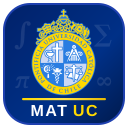

# Math Academy UC — Licenciatura en Ingeniería en Ciencia de Datos

Versión local, minimalista y personalizada de **Math Academy** diseñada específicamente para la malla curricular de la **Licenciatura en Ingeniería en Ciencia de Datos** de la Pontificia Universidad Católica de Chile (UC).

## Inicio Rápido en tu Laptop Ubuntu

No requiere instalar paquetes externos (`pip` / `npm` innecesarios). Usa Python 3 nativo + SQLite + KaTeX local (funciona **100% offline**):

```bash
./start.sh
```

Luego abre en tu navegador: **`http://127.0.0.1:8765`**

---

## Arquitectura Pedagógica (Inspirada en Math Academy)

1. **Grafo de Conocimiento Dirigido (DAG) — Semestres 1 a 4 UC**:
   - **Semestre 1 (Actual)**: *Introducción al Cálculo*, *Introducción a Álgebra y Geometría*, *Taller de Matemáticas y Estadística*.
   - **Semestre 2 (Anticipación inmediata)**: *Cálculo I*, *Álgebra Lineal para Ciencia de Datos*.
   - **Semestre 3 (Anticipación)**: *Cálculo para Ciencia de Datos*, *Álgebra Lineal Avanzada y Modelamiento (SVD/PCA)*, *Matemáticas Discretas*.
   - **Semestre 4 (Anticipación)**: *Optimización para Ciencia de Datos*, *Modelos Probabilísticos*.
2. **Motor FIRe (*Fractional Implicit Repetition*)**:
   - En el piloto, cada acierto en una pregunta auditada de un repaso aprobado aporta una fracción de repaso a las habilidades que ejercita. El resultado muestra la operación observada y cuánto se aplazó la fecha.
   - Inicia el servidor con `FIRE_ENABLED=0` para estudiar con el control de repasos directos. Para comparar políticas desde el mismo progreso, usa dos copias SQLite del mismo respaldo.
3. **Micro-Lecciones + Puentes a Ciencia de Datos + Tips de Interrogación UC**:
   - Cada nodo incluye teoría formal al grano, conexión explícita con Machine Learning / Data Science, estrategia para Interrogaciones UC (I1/I2/I3/Examen), ejemplo resuelto paso a paso y problemas tanto curados como generados paramétricamente al vuelo.
